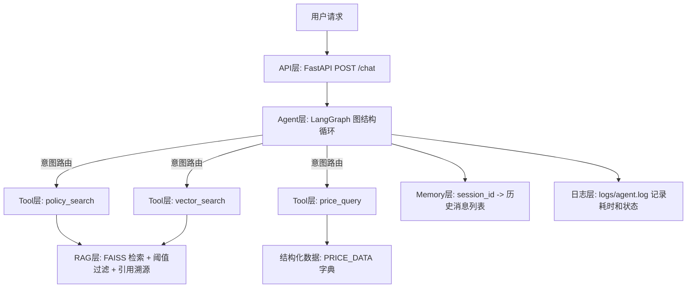

# Agentic RAG 新能源政策问答系统

面向新能源（光伏、储能）企业政策研究员和市场分析师的 AI 助手。解决政策分散、检索不准、单轮问答无法追问的痛点，提供带出处（citations）的多轮问答、精准电价查询和失败降级能力。

## 🚀 核心功能

1. **多轮对话**：基于 `session_id` 注入历史，连续 5 轮对话不丢上下文，支持指代消解（如“它”、“刚才那个政策”）。
2. **工具路由**：基于 LLM 和 docstring，自动将问题分流到 `policy_search`（政策条款）、`price_query`（电价数字）或 `vector_search`（通用概念）。
3. **失败降级**：结构化处理超时、返回空等异常。无结果时返回自然语言兜底话术，绝不把裸 JSON 抛给用户。
4. **引用输出**：每条基于文档的回答强制附带 `citations` 列表，包含来源文件（source）、相似度分数（score）和内容摘要。

## 🛠 技术栈

- **语言**：Python 3.12
- **接口**：FastAPI + Pydantic (提供 422/500 校验)
- **框架**：LangChain 1.x + LangGraph (Agent 执行图)
- **向量库**：FAISS (基于 Windows 兼容性决策，由 Chroma 迁移)
- **大模型**：智谱 GLM-4.7-flash (对话) + embedding-3 (向量化)
- **测试**：pytest (11个端到端用例)

## 🏗 架构图



## 💻 怎么跑

### 1. 安装依赖
```powershell
cd E:\python_projects\langchain_agent\agentic_rag_energy
python -m venv .venv312
.\.venv312\Scripts\Activate.ps1
pip install -r requirements.txt
```

### 2. 配置环境变量
在项目根目录（或主项目根目录）创建 `.env`，填入：
```env
ZAI_API_KEY=你的智谱API_KEY
ZAI_BASE_URL=https://open.bigmodel.cn/api/paas/v4/
```

### 3. 建库（首次运行）
```powershell
python -m rag.build_index
```

### 4. 启动服务
```powershell
uvicorn api.routes:app --host 127.0.0.1 --port 8000
```

### 5. 接口测试示例 (PowerShell)
```powershell
$body = @{session_id="demo"; message="新型储能备案需要什么材料"} | ConvertTo-Json
Invoke-RestMethod -Uri "http://127.0.0.1:8000/chat" -Method Post -Body $body -ContentType "application/json; charset=utf-8"
```

## ✅ 测试与验收

- **端到端测试**：`pytest agent/test_e2e.py -q`，**11/11 全部通过**，覆盖正常路由、边界查询、降级拦截和 422 接口校验。
- **演示视频**：见 `day13\demo_video.mp4`（展示了多轮、路由、降级、引用 4 个核心功能）。

## ⚠️ 已知限制

1. **Memory 存储**：目前使用单进程内存 dict 存储历史，重启服务丢失，未来计划迁移至 Redis。
2. **阈值召回**：FAISS 检索使用硬阈值（1.02），部分语义相近词可能被过滤，后续引入 Reranker 优化。
3. **LLM 算术**：大模型直接做数学计算不可靠，目前电价差值由工具硬编返回，并禁止 LLM 自行计算。